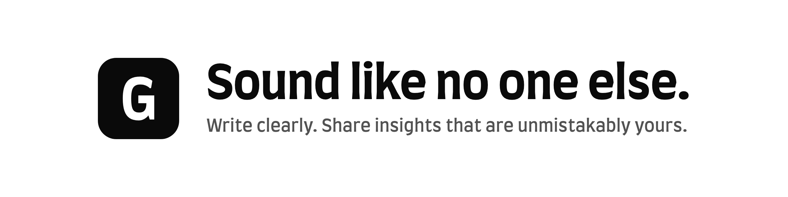

<picture>
  <source media="(prefers-color-scheme: dark)" srcset="banner-dark.png">
  
</picture>

# Galascribe

**Sound like no one else.** Write clearly. Share insights that are unmistakably yours.

Galascribe is a writing platform for the AI era. When AI makes everyone's writing sound the same, your own voice is what stands out. Galascribe helps you write clearly, say what only you can, and publish it on a site you own.

## For creators on YouTube

Galascribe also turns your videos into written articles, in your own words.

1. **Three free sample articles.** We write them from your own videos so you can judge the result.
2. **You approve.** Nothing goes live until you say so.
3. **Hosted on your domain.** Cancel any time and keep the files.

[What you get and the price](https://app.galascribe.com/creators)

## Links

- [Galascribe](https://galascribe.com)

## Social

- [About](https://app.galascribe.com/about)
- [Blog](https://blog.galascribe.com)
- [Dev.to](https://dev.to/galascribe)
- [LinkedIn](https://linkedin.com/company/galascribe)
- [Medium](https://medium.com/@galascribe)
- [X](https://x.com/galascribe)

## Open source

The source behind Galascribe is public in our engineering organisation, [rathnasgala2](https://github.com/rathnasgala2), and published on npm under the `@rathnasgala2` scope:

- [`@rathnasgala2/template`](https://www.npmjs.com/package/@rathnasgala2/template): the publication renderer
- [`@rathnasgala2/schemas`](https://www.npmjs.com/package/@rathnasgala2/schemas): the JSON Schema and OpenAPI contracts
- Themes: `@rathnasgala2/theme-default`, `theme-amaze`, `theme-flashy`, `theme-minimal`, `theme-zebra` and `theme-editorial`

## Contact

[support@galascribe.com](mailto:support@galascribe.com)

Galascribe is a product of Rathnas LLC, California.
